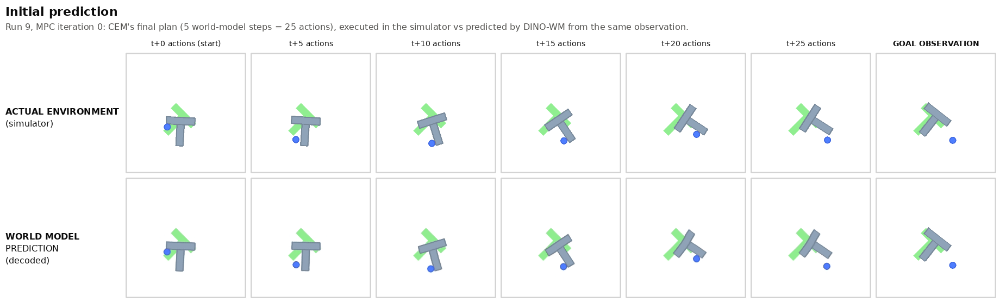
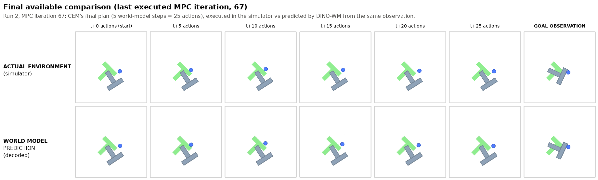
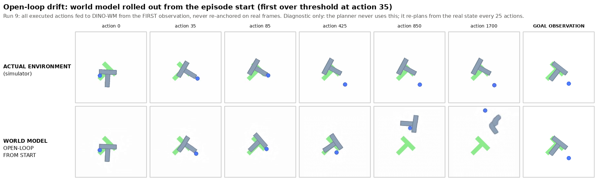

# PushT failure analysis: runs 2 and 9

**Short answer.** In both failed runs the world model's short-horizon predictions, the ones the
planner actually uses, stayed accurate. The failures happened because, within its 5-step lookahead,
the planner never found a plan that the model predicted would bring the block closer to its goal.
The agent went to its own goal position and stayed there while the block did not move. The large
"prediction drift" visible in the saved `planK.png` images comes from a long open-loop rollout that
only the plotting code makes. That rollout also caused the CUDA out-of-memory crash.

Everything here was rebuilt from saved outputs. Nothing was re-run, and no original files were changed.
Script: `scripts/pusht_failure_analysis.py` (pose estimation in `scripts/pusht_pose.py`).

## Why these runs

Runs 2 and 9 are the only 2 of the 50 PushT evaluations that never reached the goal. Both stopped
with a CUDA out-of-memory error. The output folders were identified from each log's
`Planning result saved dir` line, not from folder order:

| Run | Log | Output folder | Global seed |
|---|---|---|---|
| 2 | `evaluation_logs/pusht/eval_2.log` | `plan_outputs/20261122225854_pusht_gH5` | 2 |
| 9 | `evaluation_logs/pusht/eval_9.log` | `plan_outputs/20261123015436_pusht_gH5` | 9 |

## What the saved files contain

Checked against `planning/evaluator.py`, `planning/mpc.py` and `planning/cem.py`.

| File | Top row / panel | Bottom row / panel |
|---|---|---|
| `plan_K_output_30.png` (K = MPC iteration) | Simulator executing CEM's final plan for iteration K, from the **current real state** | DINO-WM's decoded prediction of the **same plan from the same observation**. This is what the planner optimises. |
| `planK_0_failure.mp4`, `planK.png` | Simulator replaying **all** executed actions from the episode start (one frame per action) | DINO-WM rolled out **open-loop from the first observation** over all of those actions, never re-anchored on real frames. The planner never uses this. |

- Predictions exist once per world-model step (every 5 actions). The model predicts DINOv2 latents,
  and the RGB frames come from the separately trained decoder.
- The plotting code darkens simulator frames by 0.3 in [-1, 1] space (38 grey levels). This was
  reversed exactly: the result is pixel-identical to the clean `obs_0` stored in `plan_targets.pkl`.

## Videos (per run, in `run_02/` and `run_09/`)

| File | Content |
|---|---|
| `actual_simulation.mp4` | Real simulator trajectory, all 1,700 executed actions (from `plan67_0_failure.mp4`) |
| `predicted_rollout.mp4` | DINO-WM decoded prediction for every MPC planning call (69 clips of 26 frames). A red border marks each new plan. Iteration 68 was planned but never executed. |
| `actual_vs_predicted.mp4` | **Left:** ACTUAL ENVIRONMENT. **Middle:** WORLD MODEL PREDICTION. **Right:** GOAL OBSERVATION. Shown per MPC iteration from the same starting observation and the same actions. Each prediction is held for the 5 actions of its world-model step; the label says "exact match" on frames where the times line up. |
| `actual_vs_openloop_prediction.mp4` | Extra diagnostic: the real trajectory next to the open-loop rollout from the start. This shows where the drift in `planK.png` comes from. |

Images: `initial_prediction.png`, `first_visible_divergence.png`, `final_available_comparison.png`,
`openloop_divergence.png`, `progress.png`. Data: `per_iteration.csv`, `analysis.json`.

## Key observations

Block and agent poses were estimated from the frames: a T template from the start frame is fitted to
each frame. Checked on the goal frames, where the true pose is known, the error is under 1 world unit
for block position, under 1° for block angle, and about 2 units for agent position. World units are
the environment's 512-pixel coordinates. Success needs the 4 position values within 20 in total
**and** the block angle within 20°.

| | Run 2 | Run 9 |
|---|---|---|
| MPC iterations completed / planned | 68 / 69 | 68 / 69 |
| Executed environment actions | 1,700 | 1,700 |
| Final recorded state distance (after iteration 67) | 64.6 | 81.1 |
| Block distance to goal: start to end | 63.0 to 64.4 | 44.6 to 81.0 |
| Block angle error to goal: start to end | 46.5° to 33.2° | 35.4° to 99.3° |
| Agent distance to its goal position: start to end | 59.1 to 8.5 | 159.2 to 9.5 |
| Iterations with the agent within 15 of its goal position | 65 / 68 | 68 / 68 |
| Iterations in which the block was essentially still (< 2 units, < 1°) | 56 / 68 | 63 / 68 |
| Planner (5-step) prediction error after 25 actions: block position, mean / max | 2.0 / 5.2 | 1.4 / 6.7 |
| Planner prediction error: block angle, max | 3.8° | 3.3° |
| Planner prediction error: agent position, mean / max | 3.8 / 10.3 | 6.6 / 10.8 |
| Planner's own predicted block-to-goal distance, every iteration | 63 to 67 | 38 to 81 |
| Open-loop rollout from start: block position error at the end | 45 | 126 |
| Termination | CUDA OOM in iteration 68 | CUDA OOM in iteration 68 |

**Run 2.** The agent moved next to its goal position in the first iteration and stayed there. It
touched the block in 52 of 68 iterations but never pushed it far: the block never moved more than
3.1 units from its starting position, and only its angle changed, from 46.5° to 33° off the goal. The planner's
predictions matched the simulator throughout. They also correctly showed that none of its plans would
bring the block closer than about 63 units from its goal.

**Run 9.** In iteration 0 the planner drove the agent straight to its goal position, 159 units away.
On the way the agent swept through the T and rotated it 61° *away* from the goal angle; the
prediction of this was accurate (block position error 2.6, angle error 0.3°). Iterations 1–3 pushed
the block a further 40 units away. The world model predicted those pushes too (error at most 6.7 units,
same direction of motion). After iteration 3 the agent stayed near its goal position and the block
never moved again.




## Was there prediction drift?

- **In the planner's own predictions (from the real state, 25 actions ahead): no substantial drift.**
  No iteration exceeded 10 units of block position error or 5° of angle error. The only threshold
  crossings are agent-position errors just above 10 units: run 2, iteration 2 (10.3); run 9,
  iterations 22, 40 and 61 (10.4–10.8). These are small, about 4 pixels, and shown in
  `first_visible_divergence.png`. Errors did not grow over the 68 iterations (see `progress.png`).
- **In the open-loop rollout from the episode start: yes, strong drift.** It goes over the threshold
  after 30 actions (run 2) and 35 actions (run 9). By the end the predicted T is in the wrong place and
  deformed (see `openloop_divergence.png`). That rollout runs up to 340 world-model steps without any
  real observation, far beyond the 5-step horizon used for planning. So it does not explain the failure.
  **Correction:** the main report's figure "PushT failure, model drift (run 2)" (`fig08b`) is a crop of
  this open-loop rollout, so it does not show that the planner was misled.



## Separating the possible causes

1. **Prediction error: not the main cause.** The short-horizon predictions were accurate, and the
   model correctly predicted both the harmful push in run 9 and the lack of progress in run 2.
2. **CEM search / objective / horizon limits: most likely cause.** Two things point here:
   - In every iteration, the plan CEM returned was predicted by the model itself not to move the block
     towards the goal.
   - The agent reached its goal position in the first iteration and stayed there in all but 3 of the
     68 iterations.

   This fits a local minimum of the planning objective:
   - The objective scores only the last predicted frame, as image distance plus agent position and
     velocity (`alpha=1`, `mode: last`, horizon 5 = 25 actions).
   - Pushing the block towards its goal would first require moving the agent away from its own goal
     position, which raises the cost within the 25-action window.

   This is an interpretation. The candidate plans' costs were not saved, so it can't be proved from
   these outputs.
3. **Repeated ineffective MPC re-planning: yes.** In runs 2 and 9 respectively, the block stayed
   essentially still in 56 and 63 of 68 iterations while MPC kept re-planning small agent motions
   (median agent movement 2–4 units per iteration). The executed actions themselves were not saved, so
   "similar actions" is inferred from the motion.
4. **CUDA memory exhaustion: caused the termination, not the failure.** Both runs crashed in
   iteration 68 inside `evaluator.eval_actions` → `decode_obs` → `vqvae.decode`. That is the
   visualisation decoder decoding the open-loop rollout of all 345 world-model steps, which grows every
   iteration. The task had already stalled about 60 iterations earlier.

## Limitations

- The **executed actions and CEM candidate costs were not saved**, so the "objective local minimum"
  explanation is inferred from motion and predictions, not measured directly.
- Pose and agent positions are **image-based estimates**. Agent error is about 2 units, which is why
  the 10-unit agent threshold is only just crossed.
- Planner predictions exist only every 5 actions; in the videos each one is held, not interpolated.
  The per-iteration "actual" row in `plan_K_output_30.png` comes from the evaluator re-simulating the
  plan from the saved state. It matches the continuous replay to within 3.6 units for the block and
  3.4 for the agent.
- Iteration 68 was planned but never executed (crash). It appears only in `predicted_rollout.mp4`.
- The earlier report says each failure "ran 69 MPC iterations (1,725 environment actions)". In fact
  68 iterations (1,700 actions) completed, and the 69th crashed during visualisation.

## Optional targeted check (not run)

No replay is needed for the videos above. To test the objective hypothesis directly, one cheap run
would plan run 9's task with the agent-state term removed and a finite cap:

```bash
# same environment variables as run_50_evals.sh (DATASET_DIR, LD_LIBRARY_PATH, WANDB_MODE=disabled, ...)
python plan.py --config-name plan_pusht.yaml model_name=pusht ckpt_base_path=$PWD/checkpoints \
  n_evals=1 n_plot_samples=1 seed=9 objective.alpha=0 planner.max_iter=20
```

This changes the objective, so its result would be an ablation, not a reproduction number.
